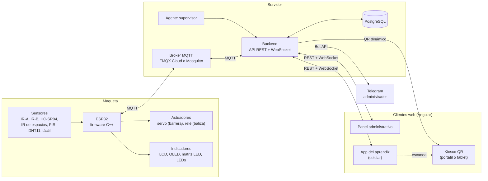
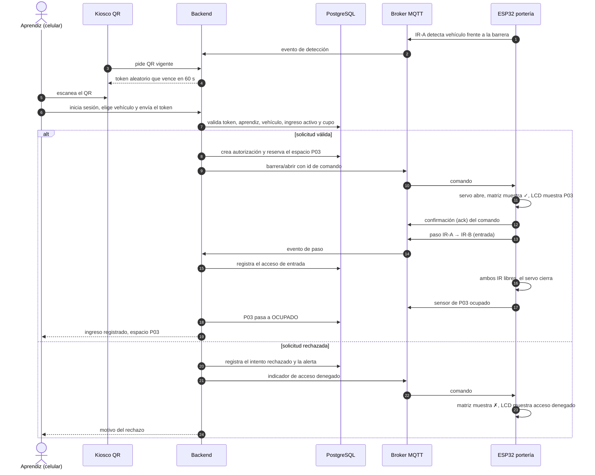
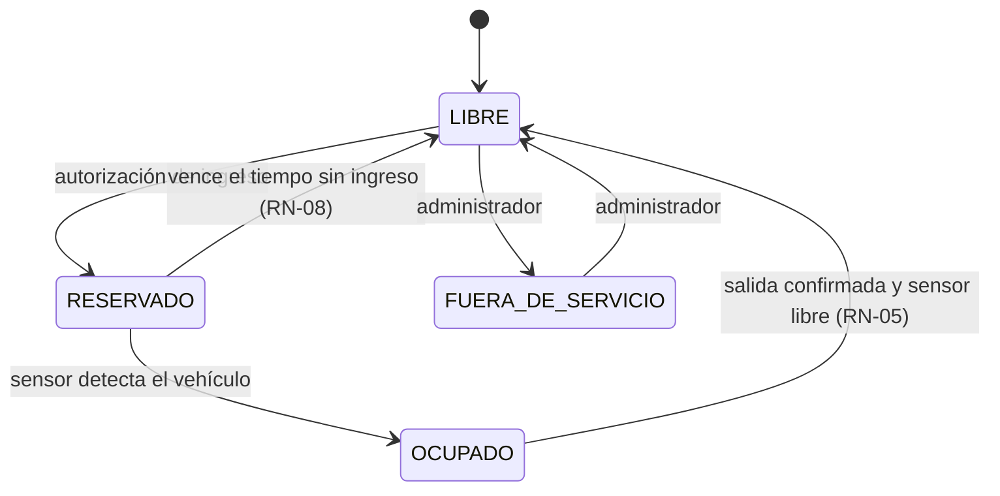
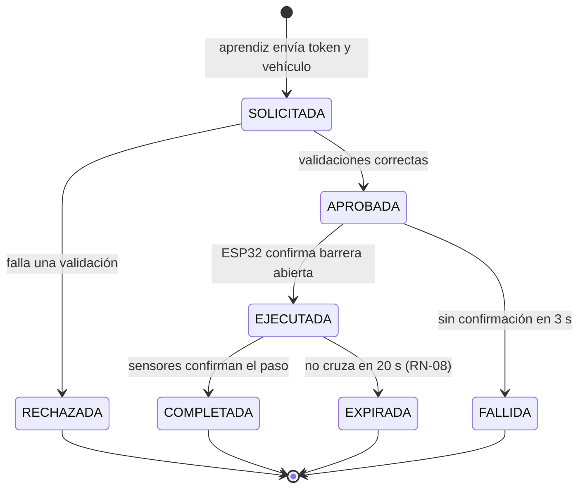

# 03 · Arquitectura

> Vista de alto nivel para la Fase 0. Los contratos detallados (tópicos MQTT, API REST, modelo de datos)
> se cierran en la fase correspondiente y se documentan en archivos propios.

## 1. Vista general



## 2. Principios de diseño

1. **El backend es la única autoridad.** El ESP32 no decide quién entra: ejecuta comandos y reporta hechos. Nunca habla directamente con la base de datos.
2. **Fail-safe.** Ante cualquier falla (sin red, sin broker, comando sin confirmar) la barrera queda **cerrada**. La única excepción es la apertura manual local, que siempre se registra.
3. **Comandos con identificador y confirmación.** Cada comando lleva un `id` único; el ESP32 responde con un *ack* y descarta ids repetidos (idempotencia).
4. **Estado físico vs. estado digital.** Los sensores y la base de datos se comparan continuamente; cualquier diferencia genera una alerta (ver §6).
5. **Privacidad por diseño.** Ni el QR ni los mensajes MQTT llevan nombres, documentos ni placas: solo identificadores técnicos (`P03`, `cmd-…`).
6. **Un paso a la vez.** Cada capa se prueba de forma aislada antes de integrarla con la siguiente.

## 3. Flujo de ingreso



**Validaciones del backend (en orden):** token existe, no ha vencido y no se ha usado → sesión válida →
aprendiz activo y autorizado → vehículo del aprendiz y aprobado → no tiene ingreso activo (RN-01) →
hay vehículo frente a la barrera (RN-06) → hay espacio libre compatible (RN-11) → dentro del horario configurado.

### Flujo de salida

Igual al de ingreso, con estas diferencias: el vehículo ya tiene un ingreso activo, así que la solicitud es de
**salida** (RN-09); el vehículo se detecta con **IR-B** (lado interior); el paso esperado es **IR-B → IR-A**; al
confirmarse se registra la fecha de salida, y el espacio vuelve a **LIBRE** solo cuando su sensor lo confirma (RN-05).

## 4. Estados de un espacio



## 5. Estados de una autorización



## 6. Detección de inconsistencias (funcionalidad diferenciadora)

| Situación | Lo que dicen los sensores | Lo que dice la base de datos | Alerta |
|---|---|---|---|
| Ocupación sin registro | P02 ocupado durante más de 60 s | No hay acceso activo asignado a P02 | Espacio ocupado sin registro |
| Espacio equivocado | P02 ocupado y P03 libre | El acceso activo tiene asignado P03 | Vehículo ubicado en un espacio diferente |
| Paso no autorizado | Paso IR-A → IR-B | No hay comando de apertura vigente | Paso no autorizado por la portería |
| Doble paso | Dos pasos durante una apertura | Una sola autorización | Posible ingreso de un segundo vehículo |
| Barrera sin respuesta | Sin *ack* en 3 s | Comando enviado | Falla de actuador |
| Dispositivo caído | Sin heartbeat en 30 s / Last Will | Dispositivo registrado como activo | ESP32 desconectado |

Estas reglas son la base del **agente supervisor** (D-09).

## 7. Tópicos MQTT (preliminar — se cierran en la Fase 2)

| Tópico | Dirección | QoS | Retenido | Uso |
|---|---|---|---|---|
| `senapark/acceso/entrada/deteccion` | ESP32 → backend | 1 | No | IR-A: vehículo esperando para entrar |
| `senapark/acceso/salida/deteccion` | ESP32 → backend | 1 | No | IR-B: vehículo esperando para salir |
| `senapark/acceso/resultado` | ESP32 → backend | 1 | No | Paso completado (dirección + id de comando) |
| `senapark/parqueadero/espacios/P01` … `P04` | ESP32 → backend | 1 | **Sí** | Ocupación de cada espacio |
| `senapark/dispositivo/estado` | ESP32 → backend | 1 | **Sí** | `online` / `offline` (Last Will) |
| `senapark/dispositivo/heartbeat` | ESP32 → backend | 0 | No | Cada 10 s: uptime, señal Wi-Fi |
| `senapark/dispositivo/temperatura` | ESP32 → backend | 0 | **Sí** | Lectura del DHT11 |
| `senapark/acceso/barrera/abrir` | backend → ESP32 | 1 | **No** | Abrir barrera (con `id`) |
| `senapark/acceso/barrera/cerrar` | backend → ESP32 | 1 | **No** | Cerrar barrera (con `id`) |
| `senapark/acceso/barrera/estado` | ESP32 → backend | 1 | **Sí** | `ABIERTA` / `CERRADA` + id del último comando |
| `senapark/acceso/indicador` | backend → ESP32 | 1 | No | Símbolo y texto para matriz y LCD |
| `senapark/dispositivo/comando` | backend → ESP32 | 1 | No | Mantenimiento, relé de baliza, reinicio |
| `senapark/porteria/presencia` *(nuevo)* | ESP32 → backend | 0 | No | PIR: persona en el kiosco |
| `senapark/acceso/manual` *(nuevo)* | ESP32 → backend | 1 | No | Apertura con el botón táctil |

**Regla importante:** los **comandos nunca se publican como retenidos**; si no, el ESP32 volvería a abrir la barrera
cada vez que se reconecte.

Ejemplo de comando (backend → ESP32, `senapark/acceso/barrera/abrir`):

```json
{ "id": "cmd-7f3a9c", "espacio": "P03", "direccion": "ENTRADA", "timeout_s": 20, "ts": "2026-11-10T14:03:22Z" }
```

Ejemplo de confirmación (ESP32 → backend, `senapark/acceso/barrera/estado`):

```json
{ "id": "cmd-7f3a9c", "estado": "ABIERTA", "ts": "2026-11-10T14:03:23Z" }
```

**Para revisar en la Fase 2:**

- Incluir el id del dispositivo en el tópico (`senapark/porteria-01/...`) para admitir más de un ESP32.
- Usuarios y permisos por tópico en el broker (panel de EMQX o ACL de Mosquitto).
- La librería PubSubClient de la plantilla solo publica con QoS 0: los "QoS 1" de la tabla para mensajes que envía el
  ESP32 requieren otra librería o se compensan con confirmaciones de aplicación (D-12).
- PubSubClient limita cada mensaje a 256 bytes por defecto; se amplía con `setBufferSize()` para los JSON.

## 8. Tecnologías por capa

| Capa | Tecnología | Estado |
|---|---|---|
| Firmware | C++ (framework Arduino) en PlatformIO (ya creado en `main`); librerías PubSubClient, ArduinoJson, ESP32Servo, LiquidCrystal_I2C, Adafruit SSD1306, MD_Parola/LedControl, DHT | Propuesta (D-10) |
| Simulación | Wokwi | Propuesta |
| Broker | EMQX Cloud (plantilla del curso); Mosquitto en Docker opcional | Propuesta (D-12) |
| Backend | Node.js + TypeScript (NestJS), cliente MQTT, WebSocket | Propuesta (D-04) |
| Base de datos | PostgreSQL | Definido |
| Frontend | Angular + Angular Material, Chart.js, diseño responsive | Definido |
| Notificación | Bot de Telegram | Propuesta (D-08) |
| Despliegue | Docker Compose | Definido |
| Pruebas de API | Postman; MQTT Explorer para MQTT | Definido |
| Versiones | Git + GitHub | Definido |
