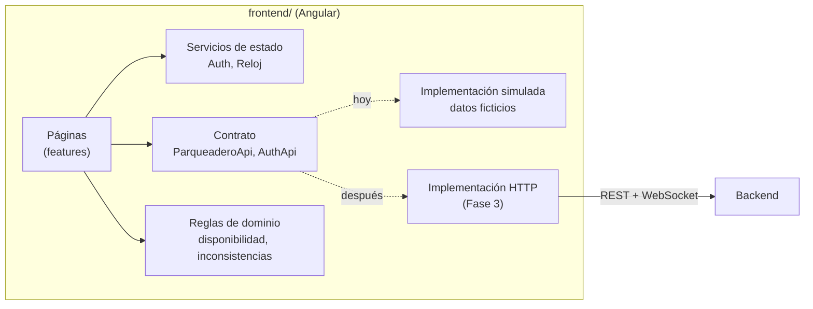

# 05 · Plataforma web

> Definición de la plataforma web (Fase 4) antes de implementarla, siguiendo el método del proyecto:
> objetivo → lógica → componentes → comunicación → relación con los demás módulos.
> El código vive en [`frontend/`](../frontend).

## 1. Objetivo

Construir la plataforma web de SENA SMART PARK — **panel administrativo** y **app del usuario** (aprendices, instructores y administrativos) — con
**datos simulados**, para:

- validar pantallas y flujos con el equipo y el instructor mientras el hardware y el backend avanzan;
- dejar definido el **contrato de datos** (modelos y operaciones) que el backend deberá cumplir en la Fase 3;
- que conectar el backend real consista en **cambiar un proveedor**, sin reescribir pantallas (decisión D-13).

## 2. Lógica general

- Las **páginas** nunca saben de dónde vienen los datos: piden todo a `ParqueaderoApi` y `AuthApi` (clases abstractas).
- Hoy esas clases se resuelven con `MockParqueaderoApi` y `MockAuthApi` (`provideApiSimulada()` en `app.config.ts`).
- Las **reglas de dominio** (qué es un espacio disponible, cuándo hay inconsistencia, qué espacio se asigna) son
  funciones puras con pruebas unitarias; el backend aplicará las mismas reglas.
- La web **nunca habla MQTT**: el backend es la única autoridad (principio 1 de `03-arquitectura.md`); la web recibirá
  los cambios en tiempo real por WebSocket.

## 3. Componentes

| Capa | Carpeta | Contenido |
|---|---|---|
| Núcleo | `src/app/core/` | Modelos, contrato de API, datos ficticios, reglas de dominio, autenticación, guardas de rol, reloj |
| Compartidos | `src/app/shared/` | Tarjeta de indicador, mapa del parqueadero, gráfico de ocupación, placa, página "en construcción", pipes |
| Diseño | `src/app/layout/` | Estructura del panel (menú lateral) y de la app del usuario (navegación inferior) |
| Funcionalidades | `src/app/features/` | `auth/`, `admin/`, `usuario/` — una carpeta por pantalla |
| Estilos | `src/styles.scss`, `src/styles/` | Tema de Angular Material con el verde SENA y tokens de color, espacios y radios |

### Rutas

| Ruta | Acceso | Pantalla | Incremento |
|---|---|---|---|
| `/login` | Público | Inicio de sesión (documento + contraseña) | 4.1 ✅ |
| `/admin/dashboard` | Administrador | Dashboard | 4.1 ✅ |
| `/admin/parqueadero` | Administrador | Mapa y detalle de espacios, asignación automática | 4.1 ✅ |
| `/admin/usuarios` | Administrador | Gestión de usuarios por categoría: aprendices, instructores y administrativos | 4.2 |
| `/admin/vehiculos` | Administrador | Gestión y aprobación de vehículos | 4.2 |
| `/admin/accesos` | Administrador | Historial de entradas, salidas, rechazos y aperturas manuales | 4.3 |
| `/admin/dispositivos` | Administrador | Estado del ESP32, sensores, actuadores y MQTT | 4.4 |
| `/admin/alertas` | Administrador | Alertas e inconsistencias | 4.4 |
| `/admin/estadisticas` | Administrador | Estadísticas de uso | 4.5 |
| `/admin/configuracion` | Administrador | Capacidad, horarios, reglas, usuarios y roles | 4.5 |
| `/app/inicio` | Usuario | Mi parqueadero: vehículo activo, disponibilidad, notificaciones | 4.1 ✅ |
| `/app/vehiculos` | Usuario | Mis vehículos | 4.2 |
| `/app/perfil` | Usuario | Mi perfil (datos según la categoría) | 4.2 |
| `/app/acceso` | Usuario | Acceso QR (escanear, elegir vehículo, resultado) | 4.3 |
| `/app/movimientos` | Usuario | Mis movimientos | 4.3 |
| `/kiosco` | Pantalla de portería | QR dinámico | 4.3 |

Las rutas de incrementos futuros ya existen y muestran qué incluirán, para que la navegación esté completa desde el inicio.

## 4. Comunicación

| Hoy (simulado) | Fase 3 (real) |
|---|---|
| `MockParqueaderoApi` responde con datos ficticios y una latencia de 300 ms | `HttpParqueaderoApi` llama a la API REST del backend |
| El estado del dispositivo y el ambiente se consultan cada 10 s | El backend empuja cambios por WebSocket (originados en MQTT) |
| `MockAuthApi` valida dos usuarios de demostración | Inicio de sesión real con token de expiración corta (RNF-02) |

Usuarios de demostración (datos ficticios):

| Rol | Documento | Contraseña |
|---|---|---|
| Administrador | `1000000000` | `admin123` |
| Usuario · aprendiz | `1012345678` | `aprendiz123` |
| Usuario · instructor | `79456123` | `instructor123` |
| Usuario · administrativo | `52789456` | `administrativo123` |

Roles y categorías (D-15): el **rol** decide qué parte de la plataforma se usa (administrador → panel, usuario →
app); la **categoría** dice quién es el usuario (aprendiz, instructor o administrativo = personal de oficina).

## 5. Relación con los demás módulos

- **Base de datos (Fase 3):** los modelos de `core/models/` reflejan las tablas propuestas (personas, vehículos,
  espacios, accesos, eventos/alertas, dispositivos, lecturas). Son el punto de partida del modelo entidad-relación.
- **Backend (Fase 3):** cada método de `ParqueaderoApi` es un endpoint que el backend debe exponer.
- **Firmware y MQTT (Fases 1 y 2):** los componentes que muestra *Estado del sistema* son exactamente los de
  `04-hardware.md`; sus valores llegarán de los tópicos de `03-arquitectura.md` §7 a través del backend.
- **Reglas de negocio:** `core/domain/reglas-parqueadero.ts` implementa RN-05, RN-11, D-02 y la tabla de
  inconsistencias (`03-arquitectura.md` §6).

## 6. Diseño visual

| Token | Color | Uso |
|---|---|---|
| Verde institucional | `#39A900` | Acentos, paleta de Angular Material |
| Verde fuerte | `#2F8A00` | Barras del gráfico, estado "libre" (contraste ≥ 3:1 sobre blanco) |
| Verde oscuro | `#1E4620` | Menú lateral, panel de inicio de sesión |
| Gris claro | `#F4F6F3` | Fondo de página |
| Rojo | `#C62828` | Espacio ocupado, alertas altas |
| Naranja | `#D9480F` | Inconsistencias físico/digital |

- Tipografía **Work Sans** e íconos **Material Symbols**, empaquetados en el proyecto: la web funciona sin internet en el salón.
- Ningún estado se comunica solo con color: siempre hay ícono y texto.
- Panel administrativo: menú lateral fijo en escritorio y desplegable en celular.
- App del usuario: barra de navegación inferior, pensada para una mano.

## 7. Incrementos

| Incremento | Contenido | Estado |
|---|---|---|
| **4.1 Base** | Proyecto, diseño, inicio de sesión, estructuras, Dashboard, Parqueadero, Inicio del usuario; roles y categorías (D-15); sin reservas (D-16) | ✅ |
| 4.2 Gestión | Usuarios y Vehículos (admin); Mis vehículos y Mi perfil (usuario) | Pendiente |
| 4.3 Accesos | Kiosco QR, Acceso QR del usuario, Control de accesos, Mis movimientos | Pendiente |
| 4.4 Operación | Dispositivos IoT, Alertas, notificaciones en la app | Pendiente |
| 4.5 Análisis | Estadísticas y Configuración | Pendiente |
| 4.6 Conexión | Reemplazar la API simulada por la del backend real + WebSocket | Depende de la Fase 3 |

Pendientes técnicos: modo oscuro, reducir el peso de la fuente de íconos (hoy ~4 MB, se descarga una sola vez).
