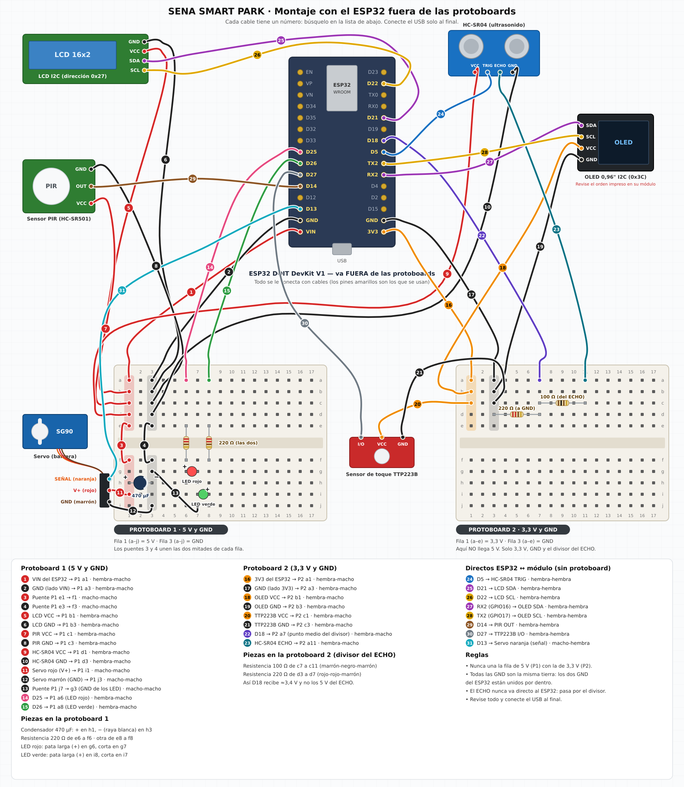

# Montaje del hardware (ESP32 fuera de las protoboards)

El ESP32 DOIT DevKit V1 de 30 pines **no cabe** en las mini protoboards de 170 puntos. Por eso va suelto y todo se le conecta con cables. Las dos protoboards solo reparten la energía y llevan las piezas que necesitan base: el condensador, los LED con sus resistencias y el divisor del ECHO.

- Imagen: [`montaje-esp32-fuera.png`](montaje-esp32-fuera.png). Se genera con `python3 docs/hardware/generar_montaje_fuera.py` (necesita `rsvg-convert` para el PNG).
- Diagrama de pines sin protoboard: [`conexiones.png`](conexiones.png).
- Los pines salen de `src/main.cpp` (líneas `PIN_*`, `SDA_*`, `SCL_*`). Si cambia uno, actualice esta guía y el script.

## Cómo es una mini protoboard de 170 puntos

- Tiene 17 filas numeradas y columnas `a`–`e` y `f`–`j`, separadas por un canal en el centro.
- En cada fila, los 5 huecos `a`–`e` están unidos entre sí. Los 5 huecos `f`–`j` también, pero no con `a`–`e`.
- No tiene rieles de alimentación. Por eso se usan filas completas como 5 V, 3,3 V y GND.
- En la imagen las protoboards están acostadas: las filas 1–17 van de izquierda a derecha.

## Reglas antes de empezar

1. Trabaje con el USB **desconectado**. Se conecta al final.
2. **P1 = 5 V y GND. P2 = 3,3 V y GND.** Nunca una la fila de 5 V con la de 3,3 V.
3. Todas las GND son la misma tierra. Los dos pines GND del ESP32 están unidos por dentro.
4. El ECHO del HC-SR04 da 5 V. **Nunca** lo conecte directo al ESP32: pasa por el divisor de P2.
5. LED: la pata larga (+) va hacia la resistencia. Condensador: la raya blanca (−) va a GND.
6. El orden de pines del OLED cambia según el modelo. Siga lo impreso en su módulo.

## Tipos de cable

| Tipo | Para qué |
| --- | --- |
| hembra-hembra | Pin del ESP32 a pin de un módulo (directo, sin protoboard). |
| hembra-macho | Pin del ESP32 o de un módulo a un hueco de la protoboard. |
| macho-macho | Puentes dentro de la protoboard y conector del servo a la protoboard. |
| macho-hembra | Señal del servo (conector hembra) al pin D13 del ESP32. |

## Paso 1: Protoboard 1 (5 V y GND)

Fila 1 = 5 V, fila 3 = GND.

| # | Desde | Hasta | Cable |
| --- | --- | --- | --- |
| 1 | VIN del ESP32 | P1 a1 | hembra-macho |
| 2 | GND del ESP32 (lado de VIN) | P1 a3 | hembra-macho |
| 3 | Puente P1 e1 | P1 f1 | macho-macho |
| 4 | Puente P1 e3 | P1 f3 | macho-macho |
| 5 | LCD VCC | P1 b1 | hembra-macho |
| 6 | LCD GND | P1 b3 | hembra-macho |
| 7 | PIR VCC | P1 c1 | hembra-macho |
| 8 | PIR GND | P1 c3 | hembra-macho |
| 9 | HC-SR04 VCC | P1 d1 | hembra-macho |
| 10 | HC-SR04 GND | P1 d3 | hembra-macho |
| 11 | Servo rojo (V+) | P1 i1 | macho-macho |
| 12 | Servo marrón (GND) | P1 j3 | macho-macho |
| 13 | Puente P1 j7 (patas cortas de los LED) | P1 g3 | macho-macho |
| 14 | D25 (LED rojo) | P1 a6 | hembra-macho |
| 15 | D26 (LED verde) | P1 a8 | hembra-macho |

Piezas en P1:

- Condensador 470 µF: + en h1, − (raya blanca) en h3. Absorbe los picos del servo.
- Resistencia 220 Ω de e6 a f6 y otra de e8 a f8. Cruzan el canal.
- LED rojo: pata larga en g6, corta en g7.
- LED verde: pata larga en i8, corta en i7.

## Paso 2: Protoboard 2 (3,3 V, GND y divisor del ECHO)

Fila 1 (`a`–`e`) = 3,3 V, fila 3 (`a`–`e`) = GND. Aquí no llega 5 V.

| # | Desde | Hasta | Cable |
| --- | --- | --- | --- |
| 16 | 3V3 del ESP32 | P2 a1 | hembra-macho |
| 17 | GND del ESP32 (lado de 3V3) | P2 a3 | hembra-macho |
| 18 | OLED VCC | P2 b1 | hembra-macho |
| 19 | OLED GND | P2 b3 | hembra-macho |
| 20 | TTP223B VCC | P2 c1 | hembra-macho |
| 21 | TTP223B GND | P2 c3 | hembra-macho |
| 22 | D18 (punto medio del divisor) | P2 a7 | hembra-macho |
| 23 | HC-SR04 ECHO | P2 a11 | hembra-macho |

Piezas en P2 (divisor del ECHO):

- Resistencia 100 Ω (marrón-negro-marrón) de c7 a c11.
- Resistencia 220 Ω (rojo-rojo-marrón) de d3 a d7.
- Resultado: ECHO → 100 Ω → fila 7 (D18) → 220 Ω → GND. D18 recibe ≈3,4 V en vez de 5 V.

## Paso 3: Cables directos ESP32 ↔ módulo

| # | Pin del ESP32 | Módulo | Cable |
| --- | --- | --- | --- |
| 24 | D5 | HC-SR04 TRIG | hembra-hembra |
| 25 | D21 | LCD SDA | hembra-hembra |
| 26 | D22 | LCD SCL | hembra-hembra |
| 27 | RX2 (GPIO16) | OLED SDA | hembra-hembra |
| 28 | TX2 (GPIO17) | OLED SCL | hembra-hembra |
| 29 | D14 | PIR OUT | hembra-hembra |
| 30 | D27 | TTP223B I/O | hembra-hembra |
| 31 | D13 | Servo naranja (señal) | macho-hembra |

## Paso 4: Revisión antes del USB

- [ ] Ningún cable une la fila 1 de P1 (5 V) con la fila 1 de P2 (3,3 V).
- [ ] El ECHO (cable 23) llega a P2 a11, no a un pin del ESP32.
- [ ] Condensador con la raya blanca en h3 (GND).
- [ ] Patas largas de los LED en g6 e i8.
- [ ] Los dos GND del ESP32 conectados (cables 2 y 17).

Después conecte el USB y suba el firmware (ver [README](../../README.md#esp32-real)). Al arrancar, los LED parpadean verde y rojo. El PIR tarda 30 s en calentar antes de dar lecturas fiables.

## Resumen de pines (firmware)

| Función | Pin | Alimentación |
| --- | --- | --- |
| HC-SR04 TRIG / ECHO | 5 / 18 (con divisor) | 5 V |
| Servo (barrera) | 13 | 5 V |
| LED rojo / verde | 25 / 26 | por resistencia de 220 Ω |
| TTP223B (toque) | 27 | 3,3 V |
| PIR HC-SR501 (P01) | 14 | 5 V |
| LCD I2C 0x27 | SDA 21, SCL 22 | 5 V |
| OLED I2C 0x3C | SDA 16, SCL 17 | 3,3 V |
